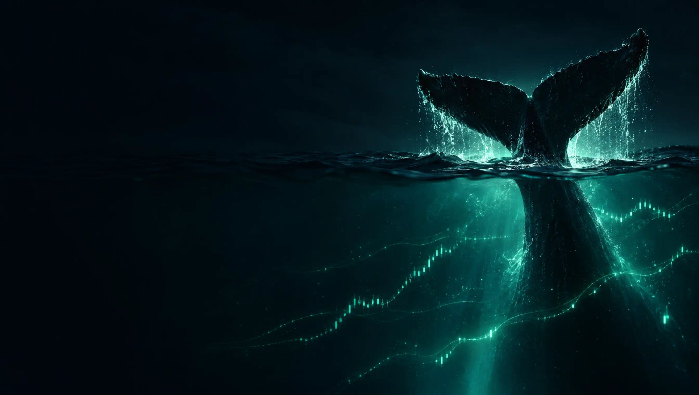

# Fluktrade ($FLUKTRADE) — Trade the Whales on Robinhood Chain

<p align="center">
  
</p>

**Fluktrade** ($FLUKTRADE) is a synthetic whale trading and tracking platform built exclusively for **Robinhood Chain** (Arbitrum Orbit Nitro L2, Chain ID `4663`, native gas `ETH`).

Every big Hyperliquid account is converted into a live tradable chart: when the whale wins on Hyperliquid, the chart goes up. Users can long or short individual whales or indexed whale pods directly using **ETH**.

---

## ⚡ Robinhood Chain Specifications
- **Network Name**: Robinhood Chain
- **Architecture**: Arbitrum Orbit Nitro L2 (EVM Compatible)
- **Chain ID**: `4663` (`0x1237`)
- **Native Gas Token**: `ETH`
- **Explorer**: [Robinhood Chain Explorer](https://explorer.robinhood.com)

---

## 🐋 Key Features

- **Trade Any Whale**: Turn top crypto whales ($4.5B+ on Hyperliquid) into longable and shortable price charts with ETH.
- **Whale Indexes**: Trade entire curated pods with a single click (*Top 10 Whales*, *Smart Money*).
- **Live Whale Moves**: Real-time streaming ticker of massive whale position flips, cuts, and additions.
- **Real & Practice Modes**: Switch instantly between real ETH trading on Robinhood Chain and risk-free practice mode.
- **Duel & Community Pool**: Engage in head-to-head whale performance duels with community-driven liquidity.

---

## 📄 Contract Address
- **Ticker**: `$FLUKTRADE`
- **Contract Address**: `0xc657D09Aaf8084E8aB1e9d7c0E8571DE80597453`
- **Network**: Robinhood Chain (EVM L2)
- **Gas / Settlement**: ETH

---

## 🚀 Deployment

Configured for zero-config static hosting on Vercel:

```bash
vercel deploy --prod
```

---

## 📜 License
MIT License.
